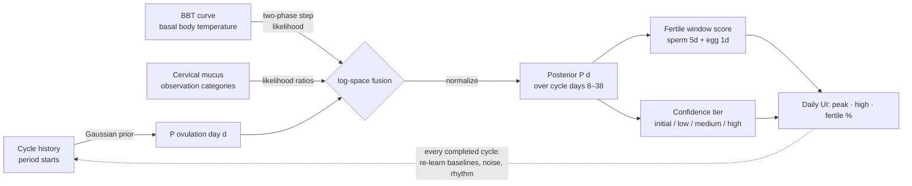

<div align="center">

# feve-bayesian-ovulation-prediction

**Self-calibrating Bayesian fertility & ovulation prediction engine — BBT + cervical mucus + cycle history, 100% on-device**

*The prediction engine behind [Feve](https://play.google.com/store/apps/details?id=com.femia.health) — a private, local-first TTC (trying-to-conceive) companion.*

[](./LICENSE)
[](./)
[](./fertility-predictor.js)

</div>

---

Most cycle apps draw one straight line: *"your cycle is 28 days, ovulation was day 14, good luck."*
Real bodies don't work that way — and women trying to conceive know it better than anyone.

**`fertility-predictor.js`** is the production algorithm inside [Feve](https://feve.life): a **Bayesian
fertility predictor** that combines cycle history, basal body temperature (BBT), and cervical mucus
observations into a full *probability distribution* over "which day was/will be ovulation" — then converts
that into a daily fertility score **with an honest measure of its own confidence**.

It is the opposite of a hardcoded day-14 calendar:

| Classic apps | This engine |
|---|---|
| Ovulation = day 14, always | Ovulation = a **learned posterior distribution** over days 8–38 |
| Fixed 28-day assumption | Predicted cycle length from **your** logged start dates — and further refined Bayesianly |
| Ignores symptoms | Consumes **BBT curve + mucus** as real evidence |
| Claims certainty | Reports **confidence tiers** (initial/low/medium/high) and a `fertilePercent` that respects uncertainty |
| Cloud sync of intimate data | **Everything computed and stored on-device** — zero network |

## How it works (plain language)

Think of it as a careful observer that updates its opinion every time you log something — the same
statistical idea behind weather forecasts:

1. **Prior** — start with what medicine knows about typical cycles (a Gaussian over likely ovulation days,
   centered on your own history when you have any).
2. **Evidence** — each logged temperature and mucus observation either *supports* or *argues against* each
   candidate ovulation day.
3. **Posterior** — multiply prior × evidence in log space, normalize, and you get a full probability
   distribution over ovulation days.
4. **Score** — "how fertile is *today*?" = the probability that ovulation lands in the next ~5 days
   (sperm lifespan) through today (egg viability).
5. **Calibrate** — when a cycle completes, the engine re-learns your baselines, temperature noise, and
   cycle rhythm, and the loop repeats — sharper every cycle.



## The math (for the curious)

### 1. The prior — what we believe before any evidence

**Ovulation day.** When the user has ≥3 inferred follicular lengths, or cycle lengths to derive them from —

```
follicular ≈ cycleLength − 12.4        (default luteal phase)
prior = Gaussian(mean, std) over days 8..38
```

Recency weighting (geometric decay, α = 0.7) makes recent cycles count more:

```
w_i = α^(n−1−i)
mean = Σ(v_i·w_i)/Σw_i
```

**Cycle length.** Averages of *valid* intervals between consecutive logged period starts (21–42 days kept),
falling back to 28.

### 2. The likelihoods — what each symptom says about each hypothesis

**BBT.** Temperatures are modeled as a two-phase step function:

```
μ(day) = preBaseline    if day ≤ hypothesized ovulation day
μ(day) = postBaseline   otherwise        (+0.3 °F typical shift)
L_BBT(d) = mean over observations of  log N(t | μ(day), σ)
```

If ovulation really happened on day *d*, today's temperature should sit near the phase-appropriate
baseline with measurement noise σ — so the curve's *shift* is real evidence.

**Cervical mucus.** Clinical likelihood-ratio tables (learnable per user): egg-white/stretchy mucus is
strong pro-evidence near ovulation (LR ≈ 4.2), dry is pro-evidence far from it — each observation
contributes log(LR).

### 3. The posterior

```
P(d | data) ∝ P(d) · L_BBT(d) · L_mucus(d)
```

Computed fully in log space with the max-subtraction trick (numerically stable), then normalized.

### 4. Self-calibration (why it gets sharper)

Every completed cycle feeds back:

- **Baselines** (pre/post-ovulation temperature) blend toward this cycle's estimates — EMA, α = 0.22
- **Noise σ** re-estimated from residuals via a MAD-based estimator, blended the same way
- **Follicular history** grows (cycleLength − defaultLuteal), re-weighting the future prior
- **Mucus likelihood ratios** become user-specific as observations accumulate

Early on the engine leans on safe, published population defaults (16.9 ± 5.3 follicular days). The more
you log, the more it narrows to **your** rhythm — and it *tells you when it can't be sure*: fertility
scores are scaled down from 70% (“initial” confidence) to 100% (“high” confidence) of their computed value.

## Honest limitations

Feve — and this engine — is a **personal lifestyle diary and cycle calendar, not a medical device.**
The estimates are statistical calculations on user-entered data; they are not clinical metrics. It is not
suitable for contraception (it's designed for the opposite goal — conceiving). See the full disclaimer in
the app or at [feve.life](https://feve.life).

## Using this code

Plain browser JavaScript, **zero dependencies**. The whole engine is one file:

```js
// Given a cycle day + observations, get the full prediction envelope:
const prediction = FeveFertilityPredictor.getPrediction(14, bbtData, mucusData);
// → { predictedOvulationDay, fertilePercent, confidence, message, posterior, ... }
```

MIT licensed — see [LICENSE](./LICENSE). If you build something with it, a link back to
[feve.life](https://feve.life) is always appreciated.

## Where this engine ships

<p align="center">
  <a href="https://play.google.com/store/apps/details?id=com.femia.health"><b>Feve on Google Play</b></a> ·
  <a href="https://feve.life"><b>feve.life</b></a> — the Feve website
</p>